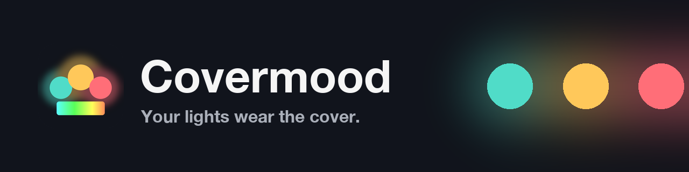
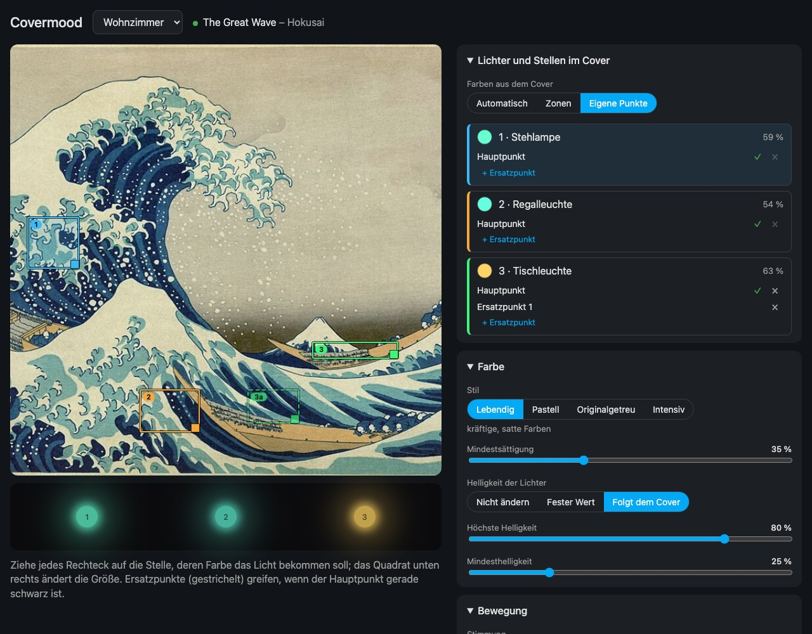
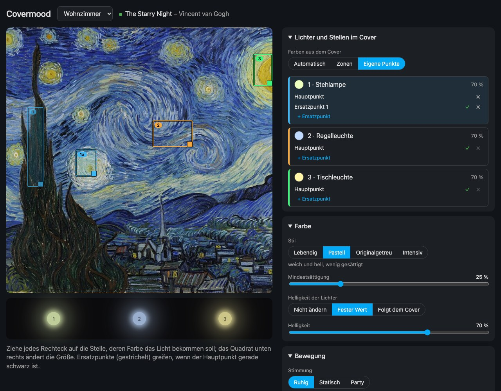
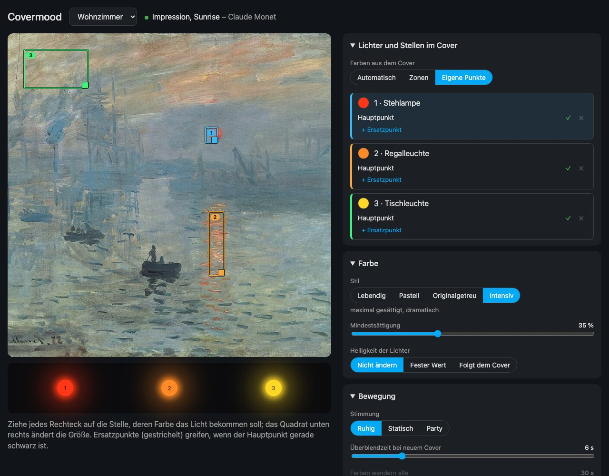

<p align="center"></p>

<p align="center"><a href="README.md">English</a> · <b>Deutsch</b></p>

<p align="center">
  <a href="https://my.home-assistant.io/redirect/hacs_repository/?owner=diggi-85&repository=covermood&category=integration"></a>
  <a href="https://github.com/diggi-85/covermood/actions/workflows/ci.yml"></a>
  
  <a href="LICENSE"></a>
</p>

# Covermood

**Deine Lichter tragen das Cover.** Du drückst auf Play, und die Lichter im Raum nehmen die Farben des Album-Covers
an – jede Lampe von genau der Stelle im Cover, die du für sie ausgesucht hast, und von Titel zu Titel sanft
überblendet. Pause, und alles kehrt in den Zustand davor zurück. Das klappt mit jedem Musikdienst, dessen Cover in
Home Assistant ankommt: Spotify, Sonos, Apple Music / AirPlay, Plex, Music Assistant und mehr.



<table>
  <tr>
    <td width="50%"></td>
    <td width="50%"></td>
  </tr>
  <tr>
    <td align="center"><sub><b>Pastell</b> – der Hauptpunkt der Stehlampe liegt auf einem dunklen Baum, also springt ihr <b>Ersatzpunkt</b> ein (✓)</sub></td>
    <td align="center"><sub><b>Intensiv</b> – die rote Sonne, die orange Spiegelung, der rosa Himmel</sub></td>
  </tr>
</table>

<sub>Screenshots mit Beispieldaten und gemeinfreien Kunstwerken (siehe [Quellen](#quellen)).</sub>

## Warum du es lieben wirst

- 🎯 **Du bestimmst, wohin jede Lampe schaut.** Zieh für jedes Leuchtmittel eine Stelle auf das Cover – die Lampe
  bekommt genau diese Farbe. Schluss mit „irgendwie schmutzigem Braun“.
- 🛟 **Ersatzpunkte.** Ist der Hauptpunkt gerade schwarz? Dann springt der nächste Punkt ein, und sind alle dunkel,
  nimmt die Lampe eine prägende Farbe des ganzen Covers. Dein Raum wird nie dunkel oder grau.
- 🖼️ **Ein Editor in Echtzeit.** Das Cover wechselt *im Editor* mit jedem Titel, und die Raumvorschau zeigt, wie deine
  Leuchtmittel glühen werden – bevor du ein echtes Licht anfasst.
- 🎨 **Vier Stile:** *Lebendig*, *Pastell*, *Originalgetreu* und *Intensiv* – dazu Regler für Mindestsättigung und
  Helligkeit. Jede Änderung wirkt sofort auf den laufenden Titel.
- 🌊 **Sanfte Übergänge.** Stell die Überblendzeit zwischen Covern ein und wie oft die Farben wandern – oder lass sie
  stillstehen.
- 🎛️ **Stimmungen Ruhig, Statisch und Party**, jederzeit umschaltbar – und eine neue Stimmung ist ein einziger Eintrag
  in einer Datei.
- 🏠 **Mehrere Räume**, jeder mit eigenen Playern, Lichtern, Punkten und Einstellungen. Räume, Player und Lichter liest
  der Assistent aus Home Assistant (Bereiche werden als Vorschlag übernommen).
- 🧯 **Rücksichtsvoll zu deinen Lichtern.** Danach kommt der vorherige Zustand zurück (oder eine Standardfarbe wird
  gesetzt), Pausen setzen nichts zurück, ausgeschaltete Lichter bleiben aus – außer du willst sie eingeschaltet haben.
- 🌍 **Deutsch und Englisch** – Einrichtungsassistent, Editor und alle Entitäten.

## Installation

### HACS (empfohlen)

1. Klick auf das Abzeichen oben – oder in HACS **⋮ → Benutzerdefinierte Repositories**, `https://github.com/diggi-85/covermood`
   als Kategorie **Integration** hinzufügen.
2. **Covermood** installieren und Home Assistant neu starten.
3. **Einstellungen → Geräte & Dienste → Integration hinzufügen → Covermood** und dem Assistenten folgen.

### Manuell

`custom_components/covermood` nach `config/custom_components/` kopieren und Home Assistant neu starten.

Benötigt Home Assistant 2025.6 oder neuer.

## Einrichten

Der Assistent hat drei kurze Schritte und beginnt mit einem Raum:

1. **Raum** – einen Home-Assistant-Bereich wählen (oder einfach einen Namen eintippen).
2. **Player und Lichter** – die Medienplayer und farbfähigen Lichter des Bereichs werden vorgeschlagen. *Die Reihenfolge,
   in der du die Lichter auswählst, ist die Richtung des Farbverlaufs.*
3. **Stimmung** – Stimmung, Herkunft der Farben, Anzahl der Farben, ob ausgeschaltete Lichter eingeschaltet werden und
   ob sie danach zurückgesetzt werden.

Alles lässt sich später im Editor ändern. Weitere Räume fügst du unter *Geräte & Dienste → Covermood → Raum hinzufügen*
hinzu.

## Der Editor

*Seitenleiste → Covermood.* Alles, was du änderst, erscheint sofort in der Vorschau und wird kurz darauf gespeichert;
die Lichter folgen, ohne dass etwas neu lädt.

| Abschnitt | Was du einstellen kannst |
|---|---|
| **Lichter und Stellen im Cover** | Woher die Farben kommen: *Automatisch* (prägende Farben), *Zonen* (von links nach rechts, wie ein Ambilight) oder *Eigene Punkte*. Bei eigenen Punkten hat jedes Licht eine Karte mit **Hauptpunkt** und **Ersatzpunkten**; die Rechtecke verschiebst du auf dem Cover und änderst die Größe am Quadrat unten rechts. Ein ✓ zeigt, welcher Punkt gerade zählt. |
| **Farbe** | Stil (*Lebendig, Pastell, Originalgetreu, Intensiv*), Mindestsättigung und Helligkeit der Lichter: *Nicht ändern*, *Fester Wert* oder *Folgt dem Cover* (zwischen Minimum und Maximum – nie dunkler als das Minimum). |
| **Bewegung** | Stimmung (*Ruhig, Statisch, Party*), Überblendzeit bei neuem Cover, wie oft die Farben wandern. Eigene Punkte behalten standardmäßig ihre Stelle; auf Wunsch **wandern sie reihum über die Lampen** (jede Lampe läuft langsam über die Farben der anderen). |
| **Wann und wie** | Nur bei bestimmten Quellen (z. B. nur Spotify, nicht der Fernseher), nur solange eine Entität an ist, ausgeschaltete Lichter einschalten, danach zurücksetzen oder am Ende stattdessen eine **Standardfarbe** setzen. |
| **An/Aus-Schalter** | Neben der Raumauswahl: schaltet Covermood für den Raum an oder aus – dasselbe wie der `switch` des Raums. |
| **Auf Lichtern testen** | Legt die aktuellen Einstellungen 10 Sekunden auf deine echten Lichter und stellt sie danach wieder her – oder die Musikfarben, wenn Musik läuft. |

Das Cover kommt vom Player des Raums – auch wenn er pausiert oder im Leerlauf ist, solange er ein Bild liefert.

## Stimmungen und Stile

| Stimmung | Verhalten |
|---|---|
| Ruhig | Farben wandern alle 30 s sanft weiter, 6 s Überblendung zwischen Covern |
| Statisch | Farben stehen still |
| Party | Farben wandern alle 2 s, schnelle Überblendungen |

| Stil | Aussehen |
|---|---|
| Lebendig | kräftige, satte Farben |
| Pastell | weich und hell, wenig gesättigt |
| Originalgetreu | so, wie das Cover es zeigt |
| Intensiv | maximal gesättigt, dramatisch |

## Entitäten je Raum

| Entität | Zweck |
|---|---|
| `switch` Aktiv | Covermood für den Raum an/aus (merkt sich den Zustand) |
| `select` Stimmung | Ruhig / Statisch / Party (gilt bis zum Neustart; im Editor lässt sich die Stimmung dauerhaft setzen) |
| `sensor` Farbpalette | aktuelle Farben des Covers (`colors`-Attribut) |
| `binary_sensor` Färbt Lichter | Diagnose: Covermood steuert gerade die Lichter |

## Gut zu wissen

- Eingeschaltete Lichter werden nur **gefärbt**, ihre Helligkeit bleibt – außer du wählst im Editor *Fester Wert* oder
  *Folgt dem Cover*. Ausgeschaltete schaltet Covermood nur **beim Start der Musik** ein (Option); wer sie danach
  ausmacht, behält recht.
- Schwarze Stellen im Cover werden nie als Farbe verwendet.
- Nur Lichter mit Farbunterstützung (HS/RGB/XY) stehen zur Auswahl.
- Ein Cover ohne Farbe (Graustufen) färbt Lichter weiß; ohne lesbares Cover bleiben die Lichter unberührt.
- Eine **Standardfarbe** ersetzt das Zurücksetzen auf den Zustand vor der Musik.
- Beim Hinzufügen oder Ändern eines Raums über *Geräte & Dienste* lädt die Integration neu; die Lichter springen dabei
  kurz in den Zustand vor der Musik zurück. Änderungen im Editor laden nicht neu.
- Mit Sonos getestet; jeder Home-Assistant-Medienplayer, der ein Cover liefert, sollte funktionieren.

## Eine Stimmung oder einen Stil hinzufügen

Eine Stimmung ist ein Eintrag in [`modes.py`](custom_components/covermood/modes.py) (`MODES`), je eine Zeile in
`translations/*.json` unter `selector.mode.options` und `entity.select.mode.state` und ihr Name in `T.modes` des
Editors (`frontend/covermood-panel.js`). Ein Stil ist ein Eintrag in `STYLES` plus `T.styles`.

## Entwicklung

Die Tests brauchen `pytest-homeassistant-custom-component`:

```bash
pip install -r requirements_test.txt
python -m pytest
```

`colors.py` (Cover → Farben → Verlauf) ist reine Python-Logik ohne Home Assistant und ein Port von `cover.ts` aus
[Ambiframe](https://github.com/diggi-85/ambiframe).

## Quellen

Die Screenshots verwenden gemeinfreie Kunstwerke von Wikimedia Commons: *Die große Welle vor Kanagawa* (Katsushika
Hokusai), *Sternennacht* (Vincent van Gogh) und *Impression, soleil levant* (Claude Monet).

## Lizenz

[MIT](LICENSE) © diggi-85
