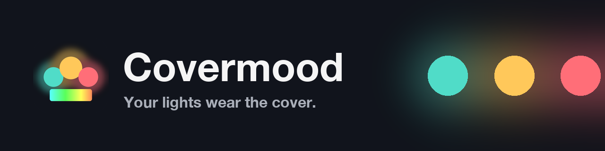
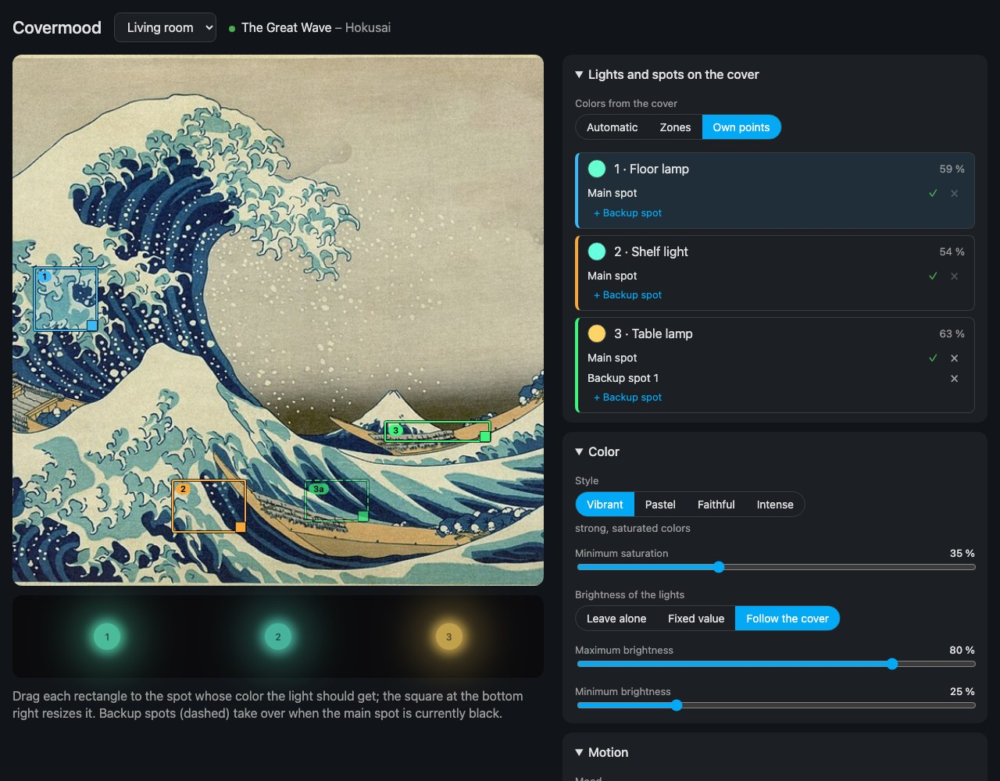
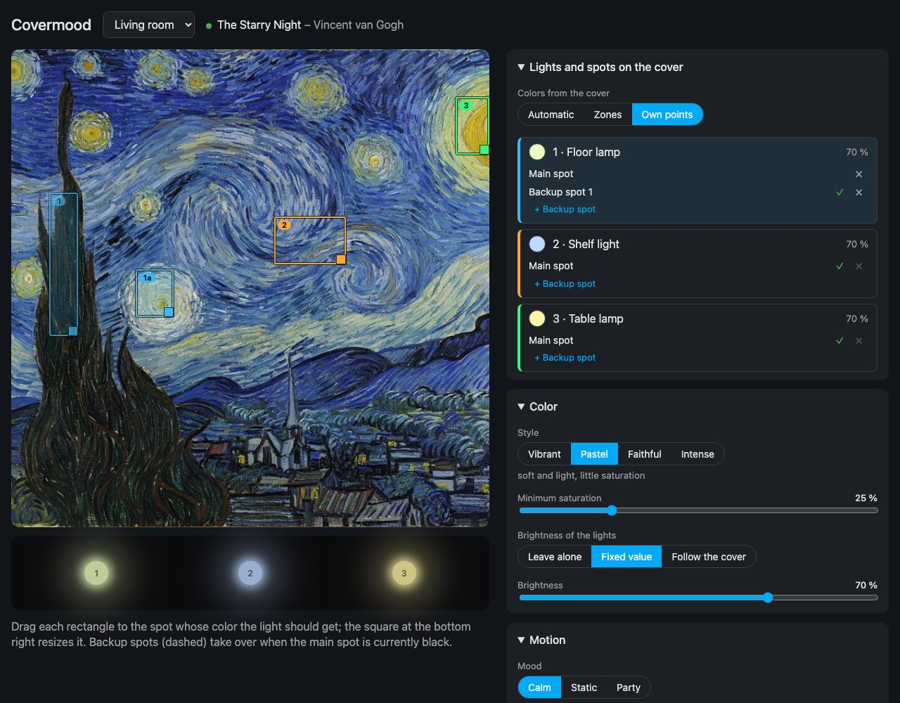
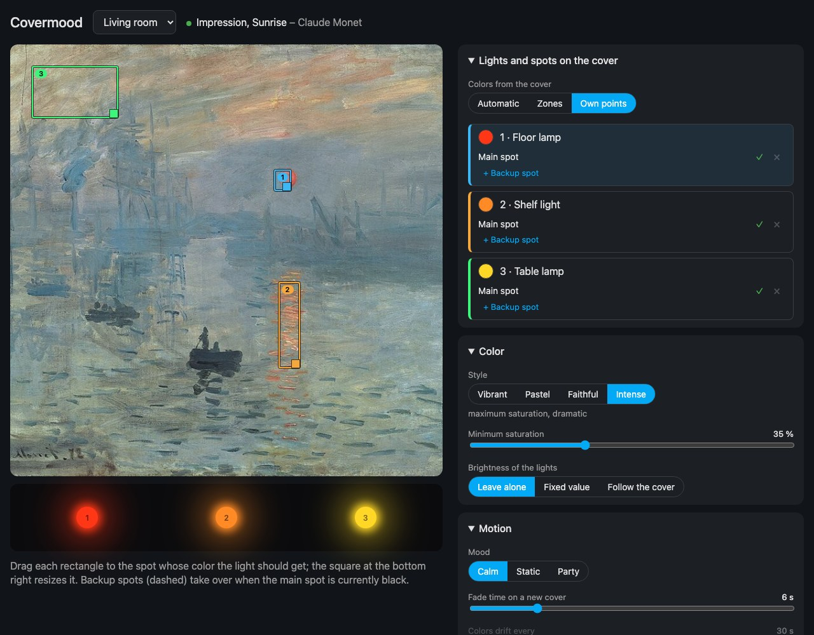

<p align="center"></p>

<p align="center"><b>English</b> · <a href="README.de.md">Deutsch</a></p>

<p align="center">
  <a href="https://my.home-assistant.io/redirect/hacs_repository/?owner=diggi-85&repository=covermood&category=integration"></a>
  <a href="https://github.com/diggi-85/covermood/actions/workflows/ci.yml"></a>
  
  <a href="LICENSE"></a>
</p>

# Covermood

**Your lights wear the cover.** Press play, and the lights in the room take on the colors of the album art – each lamp
from the exact spot on the cover you picked for it, blending smoothly from one track to the next. Pause, and they
return to how they were. It works with every music service that shows cover art in Home Assistant: Spotify, Sonos,
Apple Music / AirPlay, Plex, Music Assistant and more.



<table>
  <tr>
    <td width="50%"></td>
    <td width="50%"></td>
  </tr>
  <tr>
    <td align="center"><sub><b>Pastel</b> – the main spot of the floor lamp sits on a dark tree, so its <b>backup spot</b> takes over (✓)</sub></td>
    <td align="center"><sub><b>Intense</b> – the red sun, the orange reflection, the pink sky</sub></td>
  </tr>
</table>

<sub>Screenshots with sample data and public-domain artwork (see [Credits](#credits)).</sub>

## Why you'll love it

- 🎯 **You decide where each lamp looks.** Drag a spot onto the cover for every bulb – the lamp gets exactly that color.
  No more “somehow muddy brown”.
- 🛟 **Backup spots.** Is the main spot black right now? The next spot takes over, and if all of them are dark, the lamp
  takes a defining color of the whole cover. Your room never goes dark or grey.
- 🖼️ **A live editor.** The cover changes with every track *inside the editor*, and the room preview shows how your
  bulbs will glow – before you touch a real light.
- 🎨 **Four styles:** *Vibrant*, *Pastel*, *Faithful to the artwork* and *Intense / dramatic* – plus sliders for minimum
  saturation and brightness. Every change reaches the running track instantly.
- 🌊 **Smooth transitions.** Set the fade time between covers and how often the colors drift – or let them stand still.
- 🎛️ **Calm, Static and Party mood**, switchable any time – and a mood is a single entry in a file if you want to add one.
- 🏠 **Several rooms**, each with its own players, lights, spots and settings. Rooms, players and lights are read from
  Home Assistant (areas are suggested for you).
- 🧯 **Polite to your lights.** The previous state is restored afterwards (or a default color is set), pauses don't
  reset anything, lights that are off stay off unless you want them switched on.
- 🌍 **English and German** – the setup wizard, the editor and all entities.

## Installation

### HACS (recommended)

1. Click the badge above – or in HACS choose **⋮ → Custom repositories**, add `https://github.com/diggi-85/covermood`
   as category **Integration**.
2. Install **Covermood** and restart Home Assistant.
3. **Settings → Devices & services → Add integration → Covermood** and follow the wizard.

### Manual

Copy `custom_components/covermood` into `config/custom_components/` and restart Home Assistant.

Requires Home Assistant 2025.6 or newer.

## Set up

The wizard has three short steps and starts with a room:

1. **Room** – pick a Home Assistant area (or just type a name).
2. **Players and lights** – the media players and color-capable lights of that area are suggested. *The order in which
   you select the lights is the direction of the color gradient.*
3. **Look** – mood, where the colors come from, number of colors, whether lights that are off should be switched on,
   and whether to restore them afterwards.

Everything can be changed later in the editor. Add more rooms under *Devices & services → Covermood → Add room*.

## The editor

Open **Covermood** in the sidebar. Everything you change shows up in the preview immediately and is saved a moment
later; the lights follow without anything reloading.

| Section | What you can do |
|---|---|
| **Lights and spots on the cover** | Choose where the colors come from: *Automatic* (defining colors), *Zones* (left to right, like an Ambilight) or *Own points*. With own points every light gets a card with a **main spot** and **backup spots**; you move the rectangles on the cover and resize them with the square at the bottom right. A ✓ shows which spot counts right now. |
| **Color** | Style (*Vibrant, Pastel, Faithful, Intense*), minimum saturation, and the brightness of the lights: *Leave alone*, *Fixed value* or *Follow the cover* (between a minimum and a maximum – never darker than the minimum). |
| **Motion** | Mood (*Calm, Static, Party*), fade time for a new cover, how often the colors drift. Own points don't drift – each light keeps its spot. |
| **When and how** | Only for certain sources (e.g. only Spotify, not the TV), only while an entity is on, switch on lights that are off, restore afterwards, or set a **default color** at the end instead. |
| **Test on lights** | Puts the current settings on your real lights for 10 seconds and then restores them – or the music colors, if music is playing. |

The cover comes from the room's player – also when it is paused or idle, as long as it provides an image.

## Moods and styles

| Mood | Behavior |
|---|---|
| Calm | colors drift gently every 30 s, 6 s fade between covers |
| Static | colors stand still |
| Party | colors drift every 2 s, fast fades |

| Style | Look |
|---|---|
| Vibrant | strong, saturated colors |
| Pastel | soft and light, little saturation |
| Faithful | as the cover shows them |
| Intense | maximum saturation, dramatic |

## Entities per room

| Entity | Purpose |
|---|---|
| `switch` Active | Covermood on/off for the room (remembers its state) |
| `select` Mood | Calm / Static / Party (holds until restart; the editor sets the mood permanently) |
| `sensor` Color palette | the colors currently read from the cover (`colors` attribute) |
| `binary_sensor` Coloring lights | diagnostic: Covermood is controlling the lights right now |

## Good to know

- Lights that are on are only **colored** – their brightness stays, unless you choose *Fixed value* or *Follow the
  cover* in the editor. Lights that are off are switched on only **when the music starts** (optional); if you switch
  them off afterwards, they stay off.
- Near-black parts of a cover are never used as a color.
- Only lights with color support (HS/RGB/XY) are offered.
- A cover without any color (greyscale) colors the lights white; if no cover can be read, the lights are left alone.
- A **default color** replaces restoring the state from before the music.
- Adding or changing a room under *Devices & services* reloads the integration; the lights briefly jump back to their
  state before the music. Changes in the editor don't reload anything.
- Tested with Sonos; any Home Assistant media player that provides cover art should work.

## Add a mood or a style

A mood is one entry in [`modes.py`](custom_components/covermood/modes.py) (`MODES`), one line each in
`translations/*.json` under `selector.mode.options` and `entity.select.mode.state`, and its name in `T.modes` of the
editor (`frontend/covermood-panel.js`). A style is one entry in `STYLES` plus `T.styles`.

## Development

Tests need `pytest-homeassistant-custom-component`:

```bash
pip install -r requirements_test.txt
python -m pytest
```

`colors.py` (cover → colors → gradient) is plain Python without Home Assistant and a port of `cover.ts` from
[Ambiframe](https://github.com/diggi-85/ambiframe).

## Credits

The screenshots use public-domain artwork from Wikimedia Commons: *The Great Wave off Kanagawa* (Katsushika Hokusai),
*The Starry Night* (Vincent van Gogh) and *Impression, Sunrise* (Claude Monet).

## License

[MIT](LICENSE) © diggi-85
